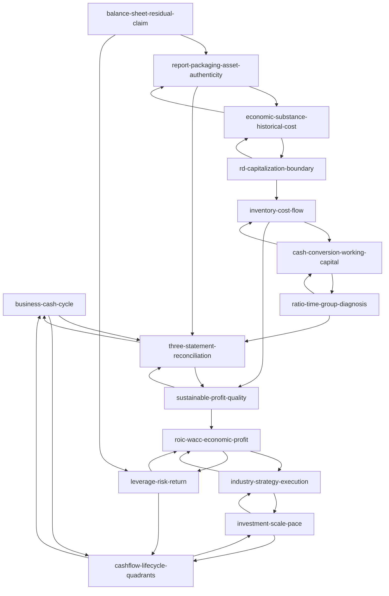

# INDEX — 《一本书读懂财报》

## Skill 总览
- [比率分析的时间匹配与成组诊断](ratio-time-group-diagnosis/SKILL.md)
- [经济实质、未来相关性与历史成本](economic-substance-historical-cost/SKILL.md)
- [行业—战略—执行三层归因](industry-strategy-execution/SKILL.md)
- [ROIC—WACC 经济利润门槛](roic-wacc-economic-profit/SKILL.md)
- [三表联读：收入、利润与现金分离](three-statement-reconciliation/SKILL.md)
- [财务杠杆与风险—收益取舍](leverage-risk-return/SKILL.md)
- [报表包装、关联交易与资产真实性](report-packaging-asset-authenticity/SKILL.md)
- [现金流八象限与企业生命周期](cashflow-lifecycle-quadrants/SKILL.md)
- [经营—投资—融资与现金循环](business-cash-cycle/SKILL.md)
- [资产现金转换与营运资金质量](cash-conversion-working-capital/SKILL.md)
- [研发资本化与不确定性边界](rd-capitalization-boundary/SKILL.md)
- [利润可持续性与一次性项目拆解](sustainable-profit-quality/SKILL.md)
- [投资规模与扩张节奏压力测试](investment-scale-pace/SKILL.md)
- [会计恒等式与剩余求偿](balance-sheet-residual-claim/SKILL.md)
- [成本流转与库存毛利幻觉](inventory-cost-flow/SKILL.md)

## 引用图

